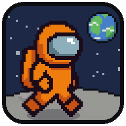
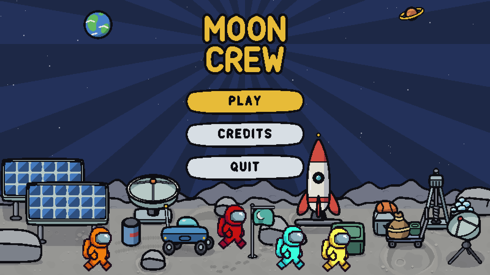
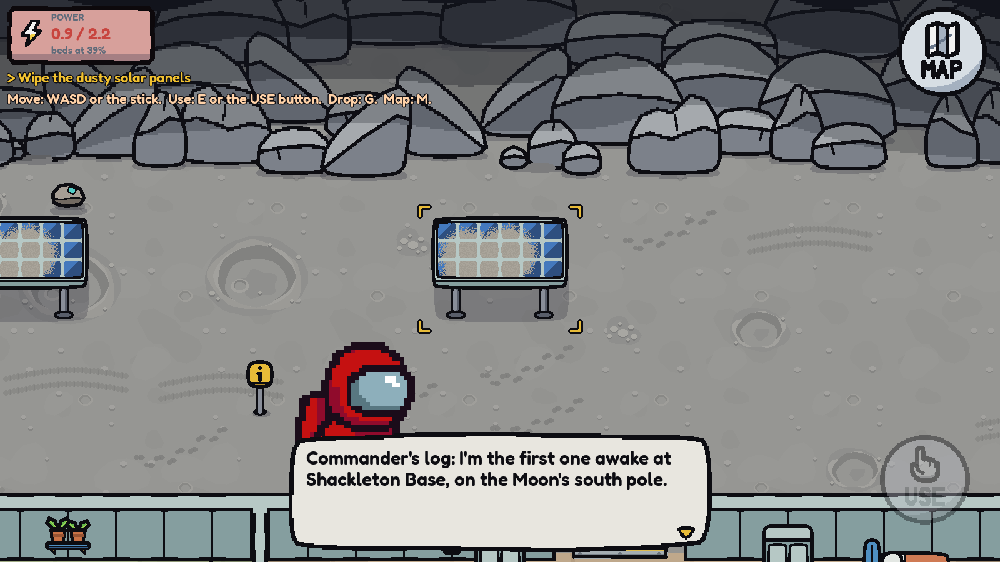
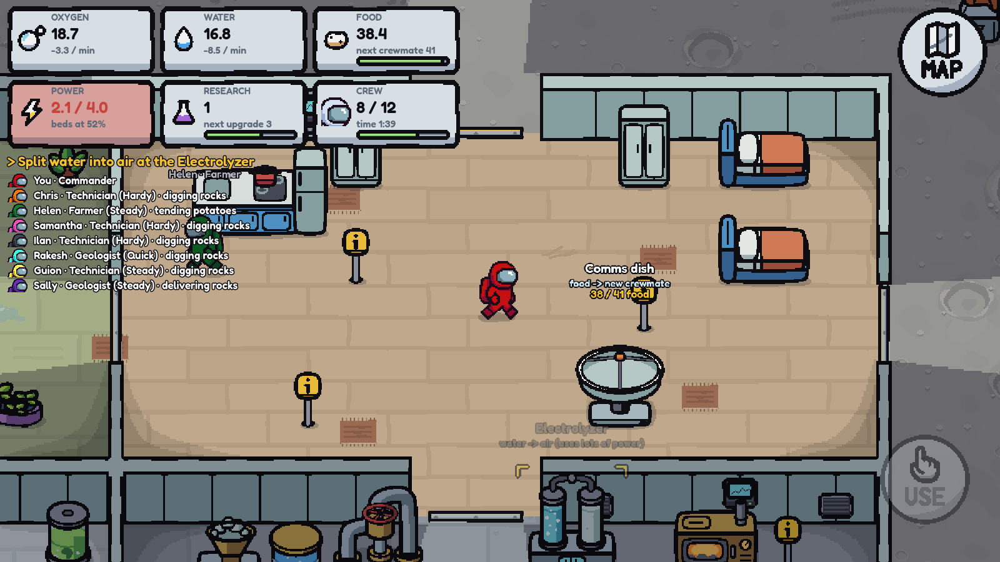
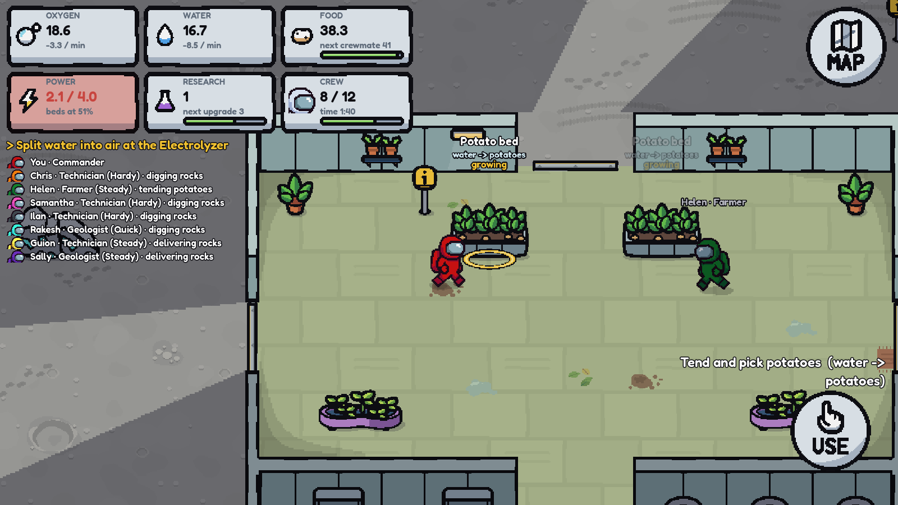
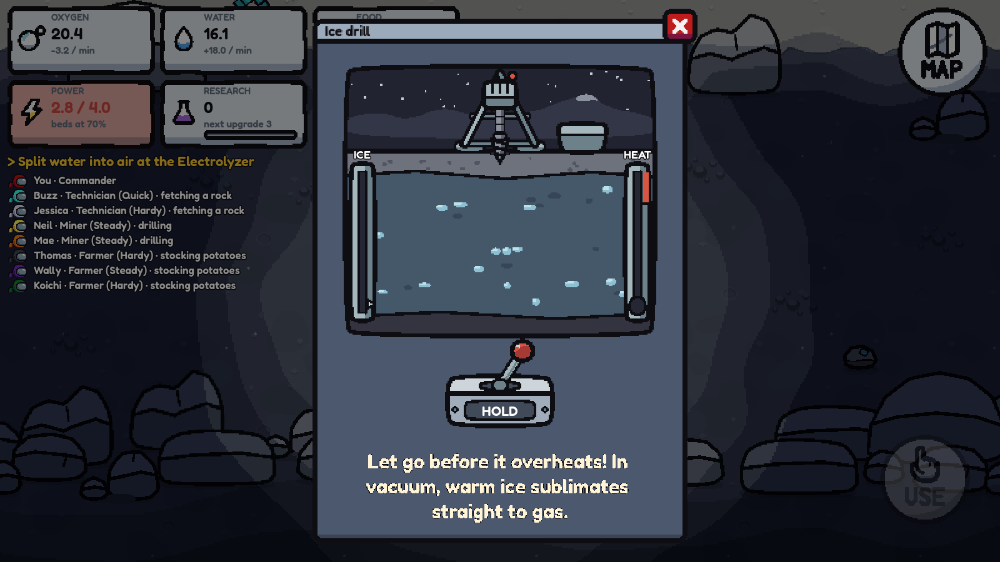
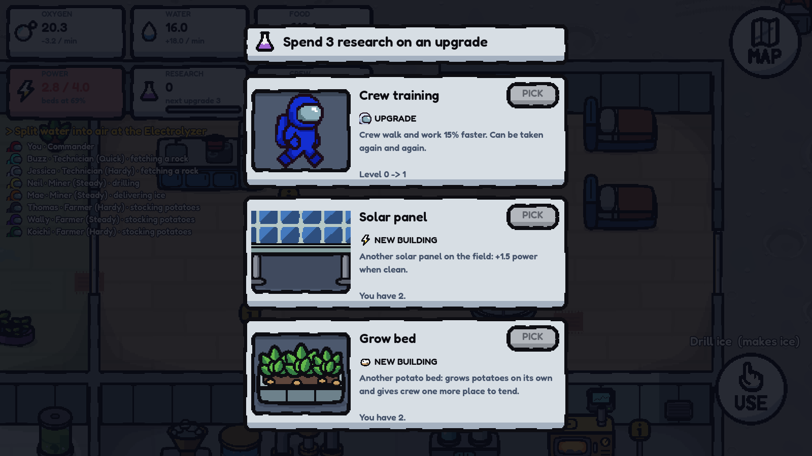
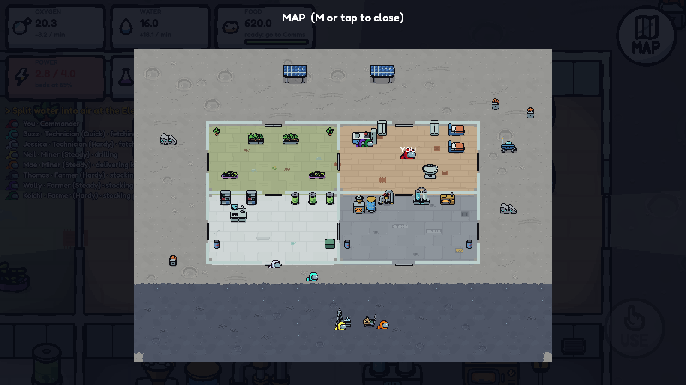

<p align="center"></p>

<h1 align="center">Moon Crew</h1>

<p align="center"><b>Run a base on the Moon's south pole and keep your crew alive.</b><br>
A NASA Space Apps Challenge entry for <i>Build a Junior Astronaut Mission Trainer</i>.</p>

<p align="center"><a href="https://hexxt-git.github.io/moon-crew/"><b>▶ Play in your browser</b></a></p>

<p align="center"></p>

## Team

- Salah Zeghdani

## The challenge

> Space-themed STEM content often oversimplifies the engineering trade-offs that define a real mission, or presents them at a level too complex to hold a young learner's attention. Design and build an interactive game or app that lets students run a lunar or Martian outpost, balancing competing demands like life support, radiation shielding, power, and food production, so they experience firsthand the decisions that determine whether a mission fails or succeeds.

Moon Crew answers it with a small, hands-on colony game. You don't read about the trade-offs: you walk to the machine, do the job yourself, and watch what it costs the rest of the base.

## How it plays

You wake up alone at **Shackleton Base**, on the rim of Shackleton crater. Everything runs on power, and every crewmate breathes, drinks and eats. One quick job at a time, you keep all of it running:

| Resource | Where it comes from | What it costs |
|---|---|---|
| ⚡ **Power** | Wipe sharp moon dust off the solar panels. Later, build a Kilopower fission reactor. | Panels get dusty again. The reactor needs cooling water. |
| 💧 **Water** | Drill ice in the permanently dark crater floor, carry it to the ice melter. | A long walk into the cold. |
| 🫁 **Air** | Split water into oxygen at the electrolyzer (2 H₂O → 2 H₂ + O₂). Later, bake oxygen out of moon rock in the ISRU oven. | Water, and a lot of power. |
| 🥔 **Food** | Tend potato beds in the greenhouse and carry the harvest to the kitchen. | Water and power. |
| 🔬 **Research** | Dig rocks at an outcrop and scan them in the lab's spectrometer. | Water, power, and rocks the oven also wants. |
| 👩‍🚀 **Crew** | Spend food at the Comms dish to call a crewmate from Earth. | Another mouth: more air, water and food every minute. |

The core trade-off is that **every resource feeds another**. More crew means more hands, but more demand. The electrolyzer and the lab both pull hard on the same power grid. The rocks you dig can become research or oxygen, not both. When air runs out, everyone slows down.

Crewmates come with a role (Miner, Farmer, Technician, Geologist) and a perk (Quick, Steady, Hardy), and pick jobs based on what the base needs most. Research buys upgrades drawn as cards (more beds and panels, a reactor, dust-repellent coating, a water recycler, better suits), and the cards lean toward whatever the base is short of. Grow the base to **12 crew** to complete the mission.

### Built to teach

- **Guided tutorial.** A commander's log walks through the loop one resource at a time (power → water → air → food → crew → research), with a trail of dots to the next job.
- **Real science in every station.** Each minigame shows a short fact: regolith is electrostatic and clings to panels, the ISS makes its oxygen by electrolysis, moon rock is about 40% oxygen by mass.
- **Field notes** scattered around the base cover the photovoltaic effect, the 14-day lunar night, cold traps, photosynthesis, spectroscopy and ISRU.
- **No timers, no punishment.** Output comes from doing the job, so a young player can always recover. A flawless drill run or rock scan earns a bonus.

## Screenshots

| | |
|---|---|
|  |  |
| The commander's log starts the tutorial | The hab, with the whole crew at work |
|  |  |
| Tending potatoes in the greenhouse | Drilling ice: let go before it overheats |
|  |  |
| Spending research on upgrades | The base map: hab, greenhouse, life support, lab and the crater |

## Controls

| | Desktop | Mobile |
|---|---|---|
| Move | WASD / arrow keys | On-screen joystick |
| Use a station | E / Space | USE button |
| Drop what you carry | G | DROP button |
| Map | M | MAP button |
| Close a panel | Q | ✕ |

## Running it

Moon Crew is built with **Godot 4.7** (GL Compatibility renderer), so it runs on desktop, mobile and the web.

1. Install [Godot 4.7](https://godotengine.org/download).
2. Clone this repo and open `project.godot` in Godot.
3. Press **F5** to play.

**Web build:** every push to `main` builds and deploys to [GitHub Pages](https://hexxt-git.github.io/moon-crew/) (`.github/workflows/pages.yml`). To build locally, use *Project → Export → Web*, which writes `build/web/index.html`. Serve that folder with any static server, for example `python3 -m http.server -d build/web`.

### Tests

Headless checks live in `tests/`:

```sh
godot --headless --path . -s res://tests/test_colony.gd
godot --headless --path . -s res://tests/test_tutorial.gd
godot --headless --path . -s res://tests/sim_balance.gd   # simulates whole runs to check the economy
```

## Project layout

```
scenes/          menu, colony, and the shared bot/workstation scenes
scripts/colony/  the game: rules (colony.gd), map, crew AI, HUD, tutorial, minigames
scripts/ui/      buttons, pixel font, task panel
assets/art/      exported pixel art (generated, don't edit by hand)
art-src/         the art sources: round-brush vector paths, pixelated with a fixed palette
tests/           headless checks and the balance simulation
design.md        art style rules
```

The props, floors and UI are drawn in code: `art-src/` holds the vector sources, and `art-src/pixel/export_godot.sh` renders them to the PNGs in `assets/art/`. The crewmate is a hand-cleaned pixel sprite (`art-src/pixel/character_sprite.png`), keyed for recolouring by `character_key.py`. `art-src/pixel/brand_art.py` builds the app icon, boot splash, HUD crew icon and the web preview image (`docs/og-image.png`) from it. See `art-src/README.md` and `design.md`.

## Credits

- The art style is heavily inspired by Among Us. Moon Crew is a hackathon entry only and is not affiliated with or endorsed by Innersloth.
- Built for the [NASA Space Apps Challenge](https://www.spaceappschallenge.org/).
- Font: [Fredoka](https://fonts.google.com/specimen/Fredoka), SIL Open Font License (`assets/fonts/OFL.txt`).
- Made with [Godot Engine](https://godotengine.org/).
- Science facts draw on public NASA material on the Artemis program, the ISS life support system, the Veggie experiment and Kilopower.
